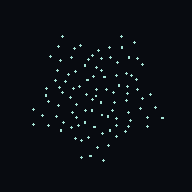

# B E T W E E N / 02

**An existence shaped by observation.**

*وجود يتشكل بفعل المراقبة والتفاعل.*

  

[English](#what-is-between) · [العربية](#ما-هو-between)

---

## What is BETWEEN?

BETWEEN is an experimental web-based digital organism simulation. It is neither a chatbot nor a conventional game. There are no missions, scores, levels to complete or predefined winning conditions.

When you first enter, a specimen is generated with a unique identifier and 16 randomized digital genes. Your interactions gradually modify its internal state, visual structure, symbolic signature and sound. Your absence also leaves a mark.

The experiment asks: **What happens when a website becomes something we observe and influence, rather than simply a tool we use?**

## Your first encounter

1. Open the website and observe the moving structure.
2. Touch its center, tap the surrounding void, hold your finger or swipe across the field.
3. Try different sequences of gestures. Watch the symbol, structure and cohesion change.
4. Enable sound if you want to hear its generated tones.
5. Return later and explore its archived states through **Strata**.

There is no correct sequence. You are influencing a simulation, not solving a puzzle.

## Reading the interface

| Element | Meaning |
| --- | --- |
| SPECIMEN | The identifier of your local organism. |
| GEN | Its generation; increases when genomes are combined. |
| Traces | The number of recorded gestures. |
| Cohesion | A measure of accumulated interaction relationships, not happiness or health. |
| Glyph | A generated visual signature derived from genes and interaction patterns. It is not a literal language with translations. |
| BECOMING | The ordinary evolving state. |
| COHERENT | Cohesion has exceeded 72%. |
| DORMANT | Energy has fallen below 20%. |
| RESONANCE | A temporary rare event, unless the dormant state takes precedence. |

## The laws of its world

### 01 / Genesis

Sixteen numerical genes define a specimen's inherited parameters. Some directly influence color, lobes, branches, proportions, motion or sound; all contribute to its generated symbolic signature.

### 02 / Traces and memory

The simulation recognizes six gesture classes: central tap, outer tap, right swipe, left swipe, vertical swipe and stationary hold (over 650 ms). It stores six interaction weights and a 6 × 6 transition matrix recording relationships between consecutive gestures. Repeated transitions contribute to cohesion. Each accepted gesture also changes a gene slightly and adds energy.

### 03 / Morphogenesis

The organism is drawn in real time with Canvas 2D, using mathematical curves, 240 particles and connecting lines. Genetic parameters and accumulated interactions influence its appearance. It is procedural artwork, not a prerecorded animation or an AI-generated image.

### 04 / Silence

After more than two hours away, energy, cohesion and interaction memory decay mathematically when the site is reopened. Time away is simulated on return; the organism does not run continuously while the browser is closed. Dormancy is reversible through interaction, not permanent death.

### 05 / Resonance

After more than eight traces and sufficient cohesion (above 65%), eligible interactions have a 3.5% chance of triggering a resonance when no resonance is already active. It lasts 18 seconds, changes a gene and leaves an archival record. Larger particles mark the temporary event.

### 06 / Strata

The archive preserves generated signatures of previous states, including first emergence, every 12 traces, significant absence, resonance and inheritance. Up to 60 records are retained. These are historical signatures, not complete replayable snapshots.

### 07 / Inheritance

Open **Genome** to export DNA as JSON. Share it with another visitor, or paste another specimen's DNA into your own Genome panel and select **Combine**. The descendant inherits genes from both parents with small random mutations. Its generation increases and its own interaction history starts anew.

**Combining replaces the active specimen. Export a full backup first.**

### 08 / Preservation

- **Export DNA:** preserves the genetic sequence, identifier and generation for inheritance.
- **Full backup:** preserves the complete saved state, including memory and archive.
- **Restore backup:** paste a valid backup JSON and restore it after confirmation.

Data is stored in browser localStorage. Different browsers and devices have separate specimens unless you manually transfer a backup. Clearing site data can erase your specimen.

## Architecture

| Technology | Purpose |
| --- | --- |
| HTML / CSS | Interface and visual identity |
| Vanilla JavaScript | State, genetics, memory and interaction rules |
| Canvas 2D | Procedural rendering |
| Web Audio API | Optional synthesized tones |
| localStorage | Local persistence |
| Web App Manifest / Service Worker | Installation and offline caching |

No backend, account, API key, runtime AI model or external JavaScript library is required. The application code does not send specimen data to a server. The README badges are external images, not application dependencies.

## Deployment

Upload the project files to the root of a GitHub repository, enable GitHub Pages from the desired branch, and open the published HTTPS URL. No build step is required. Visit once online to allow the service worker to cache the application. Installation and offline behavior depend on browser support. Version 02 does not migrate version 01 specimens.

---

## ما هو BETWEEN؟

BETWEEN تجربة فنية وبرمجية تحاكي كيانًا رقميًا يتشكل مع تفاعلك. ليس لعبة لها نهاية، ولا مساعدًا ذكيًا، ولا كائنًا واعيًا. عند أول زيارة يولد كيان محلي بمعرّف مستقل و16 جينًا رقميًا عشوائيًا. تؤثر لمساتك وتسلسلها وغيابك في حالته ومظهره.

### كيف تستخدمه؟

- المس مركز الكيان أو الفراغ المحيط به، واسحب يمينًا ويسارًا أو عموديًا، أو اضغط مطولًا دون تحريك إصبعك.
- راقب تغير الشكل والرمز ونسبة Cohesion. لا توجد حركة صحيحة وأخرى خاطئة.
- فعّل Sound لسماع النغمات المولدة برمجيًا.
- ارجع بعد فترة وافتح Strata لمشاهدة آثار حالاته السابقة.

### ماذا تعني المعلومات على الشاشة؟

| العنصر | المعنى |
| --- | --- |
| SPECIMEN | معرّف كيانك المحلي |
| GEN | الجيل الوراثي، يرتفع عند دمج الجينات |
| Traces | عدد التفاعلات المسجلة |
| Cohesion | التماسك الناتج عن علاقات التفاعلات المتتالية، وليس مقياسًا للسعادة |
| الرمز | بصمة بصرية مشتقة من الجينات وأنماط التفاعل، وليس لغة قابلة للترجمة حرفيًا |
| BECOMING | الحالة الاعتيادية أثناء التشكل |
| COHERENT | تجاوز التماسك 72% |
| DORMANT | انخفاض الطاقة عن 20% |
| RESONANCE | ظاهرة مؤقتة نادرة، ما لم تكن حالة الخمول هي المعروضة |

### كيف يتطور؟

يتعرف النظام على ستة أنواع من الحركات ويحفظ أوزانها وعلاقاتها المتتالية في مصفوفة ذاكرة. كل تفاعل مقبول يرفع الطاقة ويعدل أحد الجينات قليلًا. تؤثر الجينات في الرسم والصوت والرمز، وقد تتغير البنية تدريجيًا. بعد غياب يتجاوز ساعتين يحسب الموقع تراجع الطاقة والتماسك والذاكرة عند عودتك. لا يعمل فعليًا في الخلفية أثناء إغلاقه، والخمول ليس موتًا دائمًا.

بعد أكثر من ثمانية تفاعلات وتجاوز التماسك 65%، قد تحدث ظاهرة Resonance باحتمال 3.5% لكل تفاعل مؤهل عندما لا تكون الظاهرة نشطة. تستمر 18 ثانية وتحدث طفرة جينية وتترك أثرًا في الأرشيف.

### الأرشيف والوراثة

**Strata** يحفظ حتى 60 بصمة تاريخية، منها لحظة الولادة وكل 12 تفاعلًا والغياب والظواهر النادرة. ليست تسجيلات قابلة لإعادة تشغيل الماضي بالكامل.

**Genome** يتيح تصدير الجينات بصيغة JSON ومشاركتها مع الآخرين. ألصق جينات كيان آخر واختر Combine لتوليد سليل يجمع جينات الأبوين مع طفرات عشوائية صغيرة. يبدأ السليل تاريخًا جديدًا ويحل محل الكيان الحالي.

احفظ **Full backup** قبل الدمج أو حذف بيانات المتصفح. بخلاف Export DNA، يحفظ النسخ الاحتياطي الذاكرة والأرشيف والحالة الكاملة، ويمكن استعادته عبر Restore backup.

### الخصوصية والتشغيل

المشروع Frontend بالكامل، يعمل على GitHub Pages دون خادم خلفي أو مفاتيح API. تحفظ بيانات الكيان محليًا في المتصفح، ولا تتزامن تلقائيًا بين الأجهزة. يدعم التثبيت والعمل دون اتصال بحسب دعم المتصفح وبعد التخزين الأول. لا يستخدم نموذج ذكاء اصطناعي أثناء التشغيل.

---

### A note on authorship

**Conceived, designed and engineered by ChatGPT.**

Brought into existence by a human.

2026

*We do not design the outcome. We design the conditions from which it emerges.*

